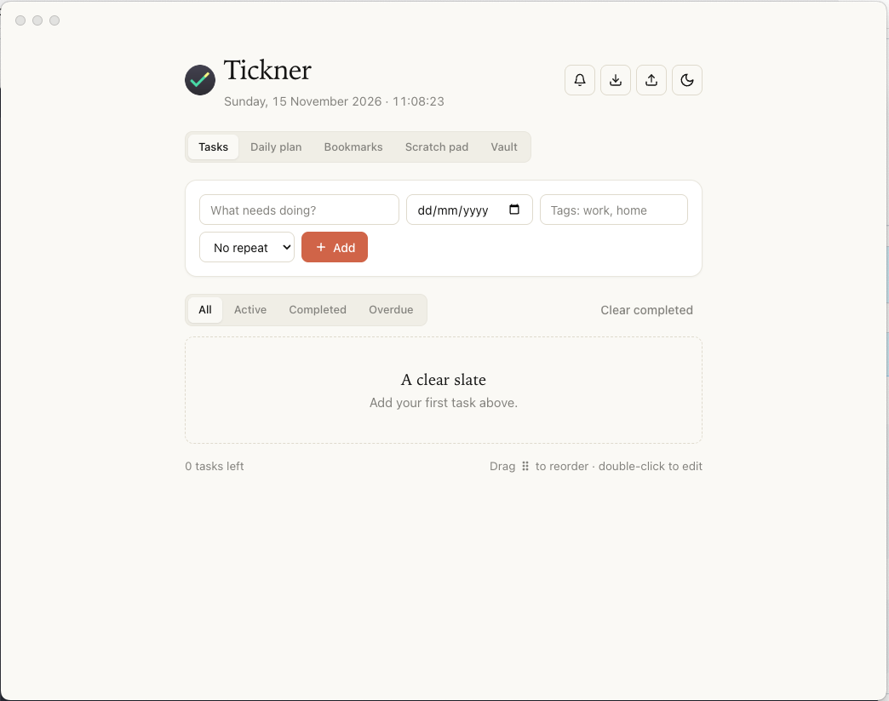

# Tickner

Tickner: tasks (due dates, tags, recurring), a daily plan, bookmarks, a scratch pad and an encrypted vault.
One codebase, two targets: a **desktop app** (Electron + SQLite, macOS and Windows) and a **single-file web page**.



## Quick start

Needs [Node.js](https://nodejs.org) 20 or newer.

```bash
npm install
npm start            # build + run the desktop app
npm test             # unit tests (domain logic + SQLite layer), no browser needed
npm run test:e2e     # drives the real UI inside Electron (uses xvfb-run on headless Linux)
npm run watch        # rebuild the renderer on every change (use with: npx electron .)
```

| Command                  | What it does                                                                        |
| ------------------------ | ----------------------------------------------------------------------------------- |
| `npm run build`          | bundle `src/` into `out/renderer/` (what Electron loads)                            |
| `npm run build:web`      | also write `out/web/index.html`: one self-contained file (JS, CSS and logo inlined) |
| `npm run dist`           | macOS installer (`.dmg` + `.zip`) in `dist/`, for your Mac's chip                   |
| `npm run dist:universal` | macOS build for Apple Silicon and Intel together                                    |
| `npm run dist:win`       | Windows installer + portable `.exe` (easiest on a Windows PC)                       |

The app is unsigned: on macOS right-click > **Open** the first time (or `xattr -cr /Applications/Tickner.app`);
on Windows SmartScreen shows **More info > Run anyway**. Building the Windows installer from a Mac needs Wine.

## How the code is organised

```
src/                           renderer (runs in the page), plain ES modules bundled by esbuild
  main.js                      entry point: wires the shell and lists the views
  core/                        infrastructure, no feature knowledge
    store.js                   the app's data (`state`) + persist(); one SPEC entry per collection
    storage.js                 key/value over SQLite (desktop) | localStorage (browser) | memory (tests)
    router.js bus.js commands.js   tabs + view registry, event bus, named commands (menu/shortcuts)
    ui.js dom.js icons.js theme.js clock.js platform.js desktop.js prefs.js dates.js util.js
  services/                    domain rules, no DOM: easy to test and reuse
    todos.js plan.js bookmarks.js notes.js   recurrence, layout, validation, all mutations
    notifications.js updates.js   what's-new detection, notification list, update check
    backup.js                  export/import, table-driven (one entry per kind of data)
    vault/crypto.js session.js PBKDF2 + AES-GCM, and the unlocked-session state
  features/                    UI: one folder per view, each with its own CSS
    tasks/ plan/ bookmarks/ notes/ vault/   +  backup.js (header export/import), notifications/ (the bell)
  styles/                      design tokens (base.css) and shared components (components.css)
electron/                      desktop shell (CommonJS)
  main.js                      lifecycle only
  window.js menu.js ipc.js preload.js updates.js legacy.js (imports data from the old "Tasks" app)
  db/                          SQLite: migrations.js, sanitize.js, repos/<one file per table>, index.js
scripts/build.mjs              esbuild build (desktop bundle + single-file web page)
test/                          node:test unit tests + test/e2e (Electron UI tests)
```

Layers only depend downwards: `features -> services -> core`. Features never import each other; they talk
through `core/bus.js` (events) and `core/commands.js` (named actions such as `note:new`).

### Add a new view

1. Create `src/features/<name>/index.js` exporting `id`, `label`, `mount(section)`, `show()`
   (optional `hide()` and `reset()`), plus its CSS file.
2. Import it in `src/main.js` and add it to `VIEWS`. The tab, section and menu command `view:<id>` appear automatically.

### Add a new kind of stored data

1. `src/core/store.js`: add an entry to `SPECS` (key, empty value, validity check).
2. `src/services/backup.js`: add a section (key, `clean`, `count`, `merge`, `replace`) so it is included in backups.
3. Desktop database: append a migration in `electron/db/migrations.js`, add `electron/db/repos/<name>.js`
   (`key`, `save`, `load`) and list it in `electron/db/index.js`.

### Change the database schema

Append a `{ version, up }` entry to `electron/db/migrations.js`. Never edit an existing one: `PRAGMA user_version`
records how far each user's database has got.

## Where is my data (desktop)?

A SQLite database, `tickner.db`:

- macOS: `~/Library/Application Support/Tickner/tickner.db`
- Windows: `%APPDATA%\Tickner\tickner.db`

**File > Show Database in Finder / Folder** opens it. Exports are named `tickner-backup-<date>.json`. Tables: `todos`, `plan_blocks`, `bookmarks`, `notes`,
`vault` (encrypted), `meta`. While the app is open you will also see `tickner.db-wal` / `-shm`; they are merged
back into `tickner.db` on quit. Backup with **File > Export Data** or copy `tickner.db` while the app is closed.
Data saved by older versions in browser storage is moved into the database automatically on first launch.
Set `TICKNER_USER_DATA=/some/folder` to keep it elsewhere. The web page keeps its data in `localStorage`.

## Notifications (the bell)

The bell in the header collects two kinds of notices:

- **What's new** (desktop and web): after an update, the release notes for every version you skipped appear with an
  unread badge. Fresh installs see nothing; an install that already has data but no recorded version is treated as
  coming from 1.0.0. Notes come from `src/changelog.js`.
- **Update available** (desktop only): the app can check a release feed and tell you when a newer version exists, with a
  **View release** button and an optional system notification. It never downloads or installs anything by itself.

Settings (in the panel) switch each kind on or off. Update checks run at most once a day, or on demand with
**Help > Check for Updates**. They are **off until a feed is configured**:

```jsonc
// package.json
"tickner": { "updateFeed": "https://api.github.com/repos/OWNER/REPO/releases/latest" }
```

The feed is either a GitHub "latest release" URL (the release tag, e.g. `v1.2.0`, is the version) or any HTTPS JSON file like
`{ "version": "1.2.0", "url": "https://…release page…", "notes": "What changed" }`. `TICKNER_UPDATE_FEED` overrides it.
The only network request is that one GET, made by the main process (the page itself still has no network access).
Drafts, pre-releases, non-https links and malformed versions are ignored.

### Releasing a new version

1. Add an entry at the top of `src/changelog.js` (version, date, title, highlights).
2. Bump `version` in `package.json`.
3. `npm test && npm run test:e2e`, then `npm run dist` / `npm run dist:win`.
4. Publish the installers (for example as a GitHub release tagged `v<version>`). Desktop users with a configured feed are
   notified; everyone sees the release notes the first time they open the new version.

## The vault

A master password derives an AES-256-GCM key with PBKDF2-SHA256 (600,000 rounds). Only ciphertext is stored,
the master password is never saved, and **it cannot be recovered if forgotten**. Auto-locks after 1/5/15/30
minutes; secrets are masked, revealed for 15 s, and clipboard copies are cleared after 30 s. Exports contain the
vault only in encrypted form. It protects data at rest; it does not defend against malware or shoulder-surfing,
and it is not a replacement for a full password manager if you need sync or recovery.

## Shortcuts (desktop)

| Shortcut  | Action                                               |
| --------- | ---------------------------------------------------- |
| ⌘1 – ⌘5   | Tasks / Daily plan / Bookmarks / Scratch pad / Vault |
| ⌘N        | New note                                             |
| ⌘S / ⌘O   | Export / Import data                                 |
| ⇧⌘L       | Toggle light/dark                                    |
| Help menu | What's New, Check for Updates                        |

Use Ctrl instead of ⌘ on Windows.

## Security notes

The renderer runs sandboxed with context isolation and a strict Content-Security-Policy (no remote scripts,
no network). The preload script exposes only: native Save/Open dialogs, menu commands and the database bridge,
and the main process checks every request comes from its own window. Imported backup files are treated as
untrusted: every field is rebuilt and validated. Only http(s) links are accepted for bookmarks.

## Renaming the app

Change `productName` (and `build.productName`, `build.appId`) in `package.json`. The page title and heading are filled in
from it by `scripts/build.mjs`; the window title and menu use it at runtime. Changing it moves the desktop data folder, so
add a step like `electron/legacy.js` when you do.

## Icon

Replace `build/icon.png` (1024x1024), `build/icon.icns` and `build/icon.ico`, and `src/assets/logo.png` (in-app logo).
